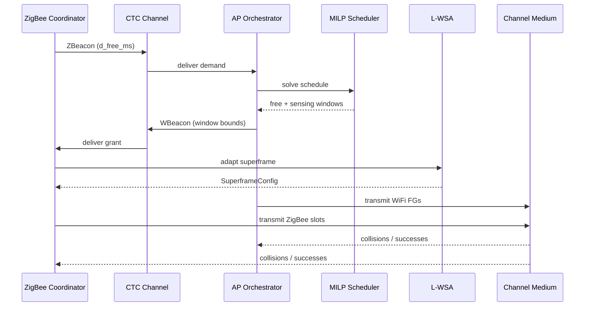
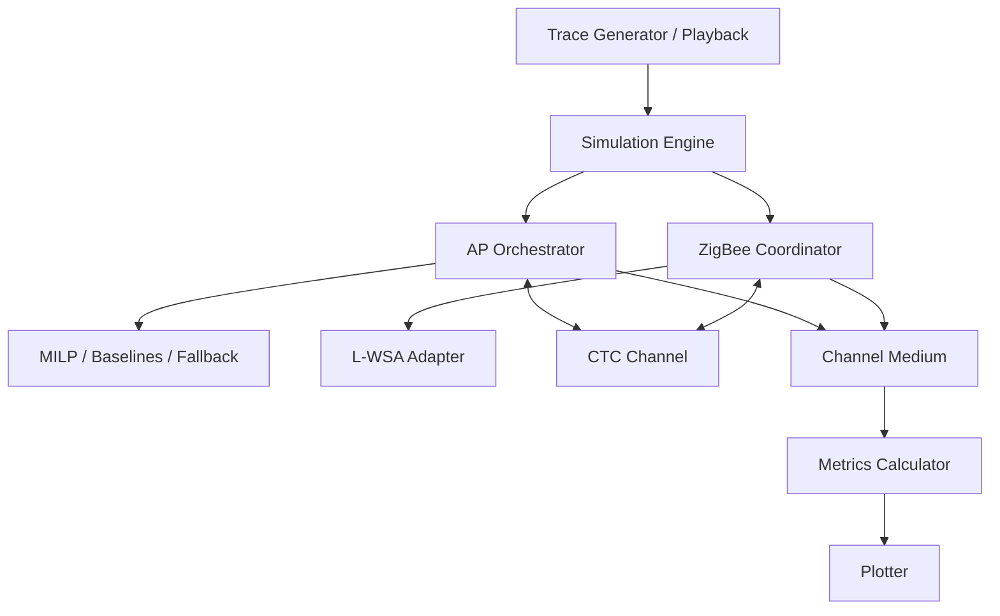

# Study Guide — Upayan Mazumder

**Presenter focus:** Central architecture  
**Registration:** 24BDS0367  
**Use this guide to prepare your presentation section.** Write style: ASD-STE100.

---

## 1. Overview for the Presentation

You own the central architecture. Explain how the whole system works as one closed loop. Cover:

- System model and data flow
- CTC link (WBeacon / ZBeacon)
- SimPy simulation engine
- Shared 2.4 GHz channel medium
- Metrics that close the evaluation loop

Nitesh covers WiFi internals. Divyansh covers ZigBee internals. Your job is to join both sides and show the shared machinery.

---

## 2. Quick Brief: Nitesh's WiFi Work

A Frame Group (FG) is a WiFi transmission batch with arrival time, duration, and deadline. The AP Orchestrator cycles through `MAINTAINING → CTC_GATHERING → RESCHEDULING → CTC_NOTIFYING → TRANSMITTING`.

In `RESCHEDULING`, the MILP solver (Equations 11–17) moves FGs to create a free window and a protected sensing window. If the MILP fails, whitespace expansion fallback runs.

Baselines:

- Exp 1: no coordination
- Exp 2: opportunistic idle-gap sensing
- Exp 3: ECC / NAV reservation with a fixed ZigBee superframe

If asked for MILP details, hand off to Nitesh after one sentence on the objective (minimise free-window overlap cost, sensing overlap, delay, and postponement).

---

## 3. Quick Brief: Divyansh's ZigBee Work

The ZigBee Coordinator (ZC) reports demand with a ZBeacon. After it receives a WBeacon, it runs L-WSA.

L-WSA searches over slot duration $t_{\text{SfSlot}}$, CAP slots $i$, CFP slots $j$, and beacon offset $t_{\text{offset}}$. Hard limits: $j \le 7$ and $i + j \le 15$. The search maximises usable CAP and CFP efficiency while avoiding residual WiFi fragments.

ZC states: `IDLE`, `CTC_REPORTING`, `COMMAND_ACQUISITION`, `TRAFFIC_ADJUSTMENT`, `SUPERFRAME_ACTIVE`.

If asked for L-WSA search details, hand off to Divyansh.

---

## 4. Deep Dive: Central Architecture

### 4.1 One full coordination cycle

Cycle steps in words:

1. ZC computes demand and sends ZBeacon.
2. AP gathers CTC demand.
3. AP solves MILP (or fallback) and places free / sensing windows.
4. AP sends WBeacon.
5. ZC parses the grant and runs L-WSA.
6. Both sides transmit into `ChannelMedium`.
7. Metrics are computed from channel records.

### 4.2 CTC channel model

Module: `src/cowic/ctc/channel.py`

| Message | Direction | Payload                                                                  |
| ------- | --------- | ------------------------------------------------------------------------ |
| ZBeacon | ZC → AP   | `d_free_ms`                                                              |
| WBeacon | AP → ZC   | `t_free_start_ms`, `t_free_end_ms`, `t_sense_start_ms`, `t_sense_end_ms` |

Notes:

- Delivery is discrete-event. There is no waveform emulation.
- Packet error rate (PER) is a configurable parameter.
- Base-paper PHY names: WiCast (downlink), SymBee (uplink). The software model abstracts them as typed control messages.

### 4.3 SimPy simulation engine

Module: `src/cowic/sim/simulation_engine.py`

Role:

- Drive AP and ZC processes on a shared SimPy environment
- Replay WiFi traces cycle by cycle
- Call orchestrator / coordinator methods at the right simulated times
- Collect channel records and pass them to metrics

The engine does not invent MAC behaviour. It wires existing modules and advances simulated time.

### 4.4 Shared channel medium

Module: `src/cowic/sim/channel_medium.py`

Role:

- Accept transmission intervals from WiFi and ZigBee
- Detect temporal overlap beyond `OVERLAP_TOLERANCE_MS`
- Mark collisions and successes
- Expose records for metrics

Collision rule in this project: temporal overlap on the shared channel causes mutual failure of the overlapping transmissions.

### 4.5 Models layer

`FrameGroup` (WiFi): identity, arrival, duration, deadline, original start, QoS flag.

`SuperframeConfig` (ZigBee): `slot_duration_ms`, `cap_slots`, `cfp_slots`, `beacon_offset_ms`, `beacon_interval_ms`.

### 4.6 Metrics

Module: `src/cowic/analysis/metrics.py`

| Metric           | Meaning                                                     |
| ---------------- | ----------------------------------------------------------- |
| $G_z$            | ZigBee gain = delivered / clean-spectrum capacity           |
| $PDR_w$          | WiFi drop rate = discarded FG duration / requested duration |
| $U_{\text{eff}}$ | Successful useful airtime / cycle length                    |
| Jitter           | Spread of WiFi FG delays                                    |
| Max delay        | Worst WiFi FG delay                                         |

Acceptance point used in the benchmark runner: Exp 4, $D_{\text{free}}=31$ ms, $T_{ZB}=1000$ ms → require $G_z > 0.9$ and $PDR_w = 0$.

Observed quick-sweep point: $G_z = 0.929$, $PDR_w = 0.0$ (PASS).

### 4.7 Full architecture diagram

---

## 5. Likely Questions and Answers

**Q1. Why software-only?**  
A. The base paper evaluates MAC-level scheduling and collision logic. SimPy + PuLP gives that fidelity without ns-3 compile cost.

**Q2. What does CTC carry in this project?**  
A. Control scalars only. ZBeacon carries demand. WBeacon carries free and sensing window bounds.

**Q3. How do you detect a collision?**  
A. `ChannelMedium` compares time intervals. Overlap beyond tolerance marks both sides as collided.

**Q4. Where does the sensing window sit?**  
A. The AP places it. The MILP hard constraint forces zero WiFi overlap with the sensing window.

**Q5. What happens if MILP fails?**  
A. The AP uses whitespace expansion fallback. It still tries to grant a usable free window without introducing avoidable postponements.

**Q6. How does the engine keep WiFi and ZigBee aligned?**  
A. Both processes run in one SimPy environment. CTC messages and cycle boundaries synchronise them.

**Q7. What is residual WiFi fragmentation?**  
A. Some WiFi FGs cannot move. They leave fragments inside the free window. L-WSA must place ZigBee slots around them.

**Q8. How is $G_z$ computed?**  
A. Delivered ZigBee payload divided by the theoretical capacity in a clean spectrum over the same interval.

**Q9. How do Exp 5 and Exp 6 help?**  
A. They are ablations. Exp 5 uses hard WiFi vacate with fixed ZigBee. Exp 6 removes sensing overhead. Together they show which parts of CoWiC matter.

**Q10. What should the audience remember from your section?**  
A. CoWiC-MAC is a closed loop: demand report → WiFi reschedule → grant → ZigBee adapt → shared-medium evaluation.
